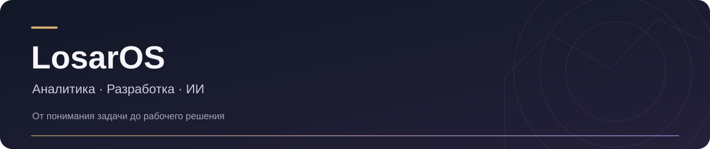

# LosarOS

[Русский](README.md) · [SHIFT](https://github.com/LosarOS/SHIFT) · [Codex Team](https://github.com/LosarOS/codex-team)

## Hi, I’m Roman

I work in systems and business analysis, including business processes in ELMA, and develop software. My interests connect requirements, system behavior and a useful result for the person using it. I am building practical experience in web development, AI agents and automation.

My approach: **understand the task → design a solution → build → verify**.

## Featured Windows products

| Project | What it helps with | Published version |
| --- | --- | --- |
| [SHIFT](https://github.com/LosarOS/SHIFT) | Local workspaces for apps, files, folders and links, with optional desktop widgets and reversible static wallpaper | [1.0.0-rc.8](https://github.com/LosarOS/SHIFT/releases/tag/v1.0.0-rc.8) |
| [Codex Team](https://github.com/LosarOS/codex-team) | A local control center for agent tasks, Git isolation, budgets, history and review | [1.0.0-rc12](https://github.com/LosarOS/codex-team/releases/tag/v1.0.0-rc12) |

Both are unsigned Windows prereleases. Automated packaging evidence does not substitute for complete physical Windows/DPI/accessibility acceptance. Codex Team is an independent product using the official Codex SDK, not an official OpenAI application; successful live SDK development is not yet verified.

## Technologies in use

C# / .NET / WinUI 3 · Python / FastAPI · SQLite · HTML / CSS / JavaScript · Git / GitHub Actions. Web projects also use React, Vite and Tailwind CSS.

## Other projects

**TM XXI** — a furniture business landing page covering services, completed work, production and an inquiry form. Built with React, JavaScript, Vite and Tailwind CSS. Source repository is private.

**[Tiny Bunny: Alternative View](https://github.com/LosarOS/TinyBunny-Alternative-View)** — an unofficial Ren’Py story mod for Tiny Bunny, with an installer and Russian instructions. [Public release 1.0](https://github.com/LosarOS/TinyBunny-Alternative-View/releases/tag/v1.0.0). Requires a purchased original game; the first version has no new voice acting.

## What I am exploring

Connecting analytical work with development: understanding applications, turning ideas into usable software, and applying AI where it helps solve a concrete task. This profile is a working portfolio of those projects and experiments.
