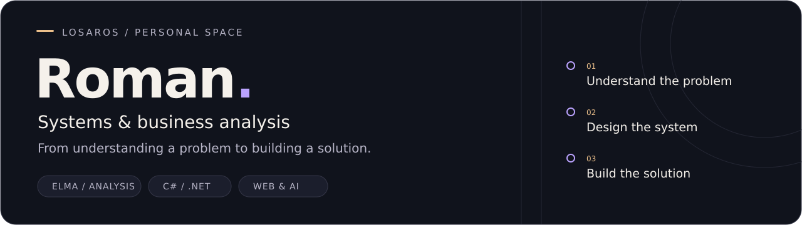
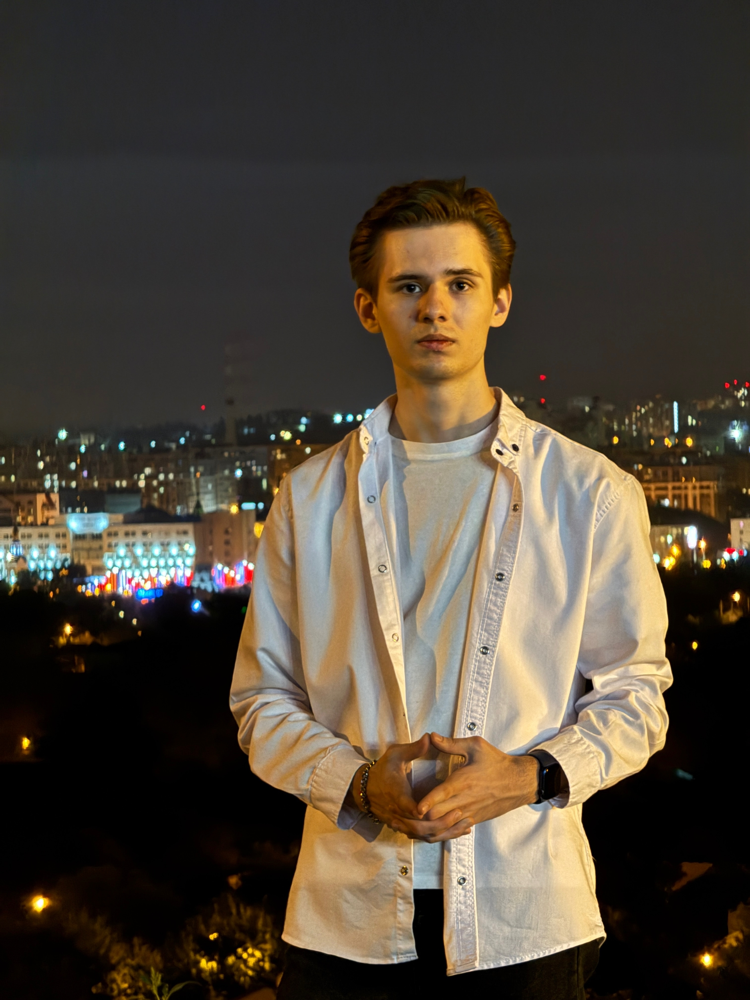
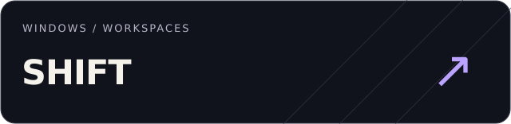
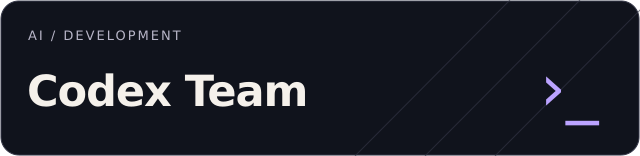

<picture>
  <source media="(prefers-color-scheme: dark)" srcset="assets/personal/hero-en-dark.svg">
  <source media="(prefers-color-scheme: light)" srcset="assets/personal/hero-en-light.svg">
  
</picture>

[Русский](README.md) · [My projects](#my-projects) · [Current focus](#current-focus)

## Hi, I’m Roman

**A systems and business analyst who enjoys building his own products.**

I work with requirements, system behavior and business processes in **ELMA**. I like understanding a problem: what a person needs, how the system should behave and what implementation will involve.

I have **one year of commercial experience** and **around 4.5 years with C#**. I am expanding my web development skills and exploring AI agents through personal projects, turning ideas into applications people can try.

**Understand the problem → design a solution → build → verify.**

 

## What I work on

| Area | My practice |
| --- | --- |
| **Analysis** | Requirements, business processes, system behavior and connecting a problem to its implementation. |
| **C# and Windows** | Around 4.5 years with the language; developing SHIFT, my own desktop application. |
| **Web** | React, JavaScript, Vite and Tailwind CSS in a real furniture business project. |
| **AI and automation** | Exploring agent workflows, context management and result review through Codex Team. |

## My projects

<table>
<tr>
<td width="50%" valign="top">
<a href="https://github.com/LosarOS/SHIFT">
<picture>
  <source media="(prefers-color-scheme: dark)" srcset="assets/personal/shift-dark.svg">
  <source media="(prefers-color-scheme: light)" srcset="assets/personal/shift-light.svg">
  
</picture>
</a>

<strong><a href="https://github.com/LosarOS/SHIFT">SHIFT</a></strong> A Windows environment of my own.

Apps, files and links in saved workspaces. Desktop widgets and Windows appearance form a separate, explicitly applied profile.

C# · .NET · WinUI 3 · SQLite

<a href="https://github.com/LosarOS/SHIFT">Source</a> · <a href="https://github.com/LosarOS/SHIFT/releases/tag/v1.0.0-rc.8">Download RC8</a>

</td>
<td width="50%" valign="top">
<a href="https://github.com/LosarOS/codex-team">
<picture>
  <source media="(prefers-color-scheme: dark)" srcset="assets/personal/codex-team-dark.svg">
  <source media="(prefers-color-scheme: light)" srcset="assets/personal/codex-team-light.svg">
  
</picture>
</a>

<strong><a href="https://github.com/LosarOS/codex-team">Codex Team</a></strong> AI agent workflows under my control.

Task plans, isolated Git working copies, budgets and agent history. Results stay under the user’s control.

Python · FastAPI · Codex SDK · Git

<a href="https://github.com/LosarOS/codex-team">Source</a> · <a href="https://github.com/LosarOS/codex-team/releases/tag/v1.0.0-rc12">Download RC12</a>

</td>
</tr>
</table>

**TM XXI — a website for a furniture business.** Services, completed work, production and an inquiry form. A practical project connecting content, interface and implementation. React / JavaScript / Vite / Tailwind CSS; source is private.

**[Tiny Bunny: Alternative View](https://github.com/LosarOS/TinyBunny-Alternative-View) — the creative side of development.** An unofficial story mod with alternative episodes IV–V, choices, endings and epilogues. Ren’Py / Windows. [Release 1.0](https://github.com/LosarOS/TinyBunny-Alternative-View/releases/tag/v1.0.0). A purchased original game is required; there is no new voice acting.

Windows project status and verification boundaries

SHIFT RC8 and Codex Team RC12 are **unsigned prereleases**. Automated Windows checks and checksums: [SHIFT report](https://github.com/LosarOS/SHIFT/blob/main/reports/RELEASE-PUBLICATION-2026-11-15.md) · [Codex Team report](https://github.com/LosarOS/codex-team/blob/master/reports/RELEASE-PUBLICATION-2026-11-15.md). Complete physical Windows/DPI acceptance is separate. Successful live SDK development is unverified; the bounded experiment stopped at AUTH_REQUIRED. Codex Team is an independent project using the official SDK, not an official OpenAI application.

## Current focus

Deepening my web development skills, exploring AI agents and improving my Windows tools. I want to connect analytical work with code: understand the whole system and turn a solution into a useful user experience.

This profile is where I share projects, experiments and what I learn along the way.
