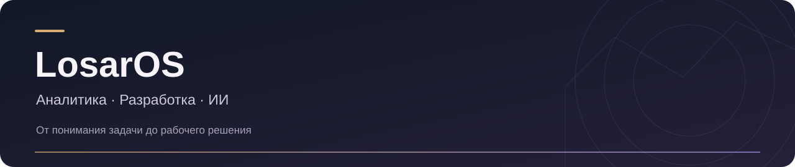

  

## Привет, я LosarOS

Я системный и бизнес-аналитик с интересом к разработке. Мне нравится разбираться, как устроена задача: что нужно бизнесу, как это должно работать в системе и каким будет результат для человека.

Работаю с задачами full-stack аналитики и анализом бизнес-процессов в **ELMA**. У меня **год коммерческого опыта**, а с **C# — около 4,5 лет**.

Постепенно расширяю практику веб-разработки и погружаюсь в **ИИ**: изучаю работу агентов, пробую автоматизацию и собираю собственные инструменты. Здесь делюсь тем, что из этого получается — от приложения для разработки до мебельного лендинга и игрового мода.

**Мне интересен весь путь: понять задачу → продумать решение → собрать → проверить.**

 

---

## Опыт и направления

| Направление | Чем занимаюсь |
| --- | --- |
| **Системная и бизнес-аналитика** | Требования, логика систем и связь бизнес-задачи с реализацией |
| **Бизнес-процессы · ELMA** | Анализ процессов; год коммерческой практики |
| **C#** | Около 4,5 лет опыта с языком |
| **Веб-разработка** | Развиваю практику на реальных проектах; React, JavaScript, Vite и Tailwind CSS |
| **ИИ и автоматизация** | Изучаю агентные сценарии и применение ИИ в разработке |

## Мои проекты

### 01 / Codex Team

**Локальная команда ИИ-агентов в приложении для Windows.**

Идея проекта — собрать работу над задачей в одном месте: анализ, изменения в коде, тесты и ревью. У каждого агента своя роль и отдельный диалог, а пользователь видит ход работы и принимает результат.

В приложении есть изолированные рабочие копии Git, история задач, пауза и продолжение, просмотр изменений и Центр действий. Подключение построено на официальном Codex SDK, основной способ входа — через ChatGPT/Codex.

**Технологии:** Python · Codex SDK · Git · Windows Desktop  
**Статус:** 1.0.0-rc1; финальная приёмка ещё продолжается.

[Репозиторий и описание →](https://github.com/LosarOS/codex-team) · [Руководство на русском →](https://github.com/LosarOS/codex-team/blob/master/docs/USER_GUIDE.md)

---

### 02 / ТМ XXI

**Лендинг для мебельного бизнеса и производства.**

Сайт представляет мебель для офисов, переговорных и коммерческих пространств. В нём собраны услуги, галерея реализованных проектов, информация о производстве и оборудовании, ответы на вопросы и форма заявки.

В этом проекте сошлись содержание, интерфейс и техническая часть: оптимизированные изображения, обработка обращений и документация для передачи сайта администраторам.

**Технологии:** React · JavaScript · Vite · Tailwind CSS  
**Исходники:** закрытый репозиторий.

---

### 03 / Tiny Bunny: Альтернативный взгляд

**Неофициальный сюжетный мод для «Зайчика».**

Альтернативное развитие IV–V эпизодов: новые сцены, решения и последствия, десять групп финалов, эпилоги и дополнительные микроистории. Для проекта подготовлены установщик, иллюстрации и инструкция на русском.

Это творческая часть моего портфолио: работа с интерактивной историей, игровыми сценами и оформлением выпуска. Мод требует приобретённой оригинальной игры; новой озвучки в первой версии нет.

**Среда:** Ren’Py · Windows  
**Статус:** первый публичный выпуск 1.0.

[О проекте →](https://github.com/LosarOS/TinyBunny-Alternative-View) · [Скачать выпуск →](https://github.com/LosarOS/TinyBunny-Alternative-View/releases/tag/v1.0.0)

---

## Что изучаю сейчас

Хочу глубже связать аналитическую работу с разработкой: лучше понимать веб-приложения, увереннее доводить идеи до рабочего продукта и применять ИИ там, где он помогает решать конкретные задачи.

Этот профиль — моя рабочая витрина. Здесь будут появляться новые проекты, заметки и результаты экспериментов.
