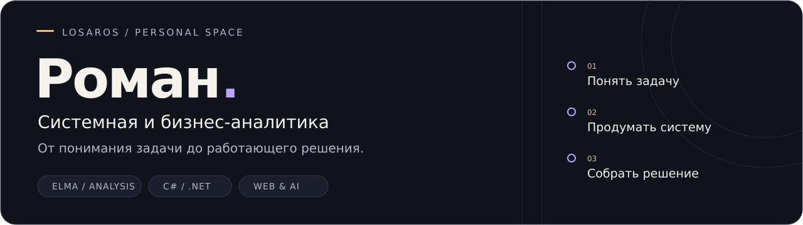
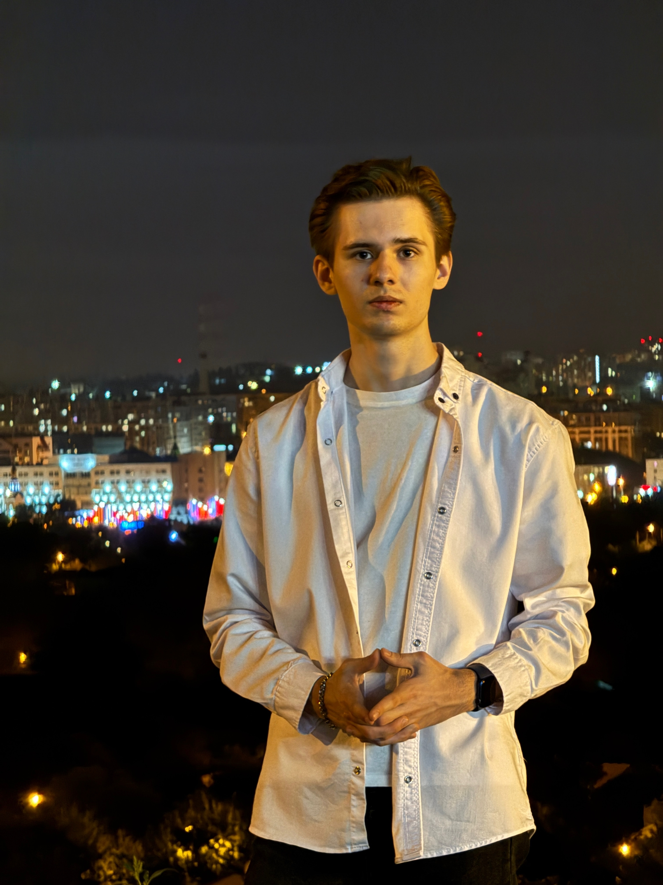
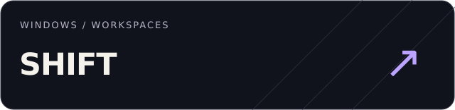
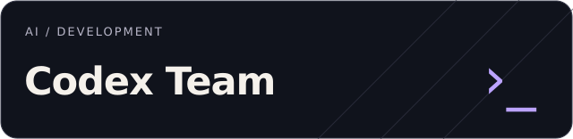

<picture>
  <source media="(prefers-color-scheme: dark)" srcset="assets/personal/hero-ru-dark.svg">
  <source media="(prefers-color-scheme: light)" srcset="assets/personal/hero-ru-light.svg">
  
</picture>

[English](README.en.md) · [Мои проекты](#мои-проекты) · [Сейчас в фокусе](#сейчас-в-фокусе)

## Привет, я Роман

**Системный и бизнес-аналитик, которому интересно создавать свои продукты.**

Работаю с требованиями, логикой систем и бизнес-процессами в **ELMA**. Мне нравится разбираться в задаче: что нужно человеку, как должна вести себя система и что понадобится для реализации.

У меня **год коммерческой практики** и **около 4,5 лет с C#**. Сейчас расширяю опыт в веб-разработке и изучаю ИИ-агентов: пробую подходы на своих проектах и довожу идеи до приложений, которыми можно пользоваться.

**Понять задачу → продумать решение → собрать → проверить.**

 

## Чем занимаюсь

| Направление | Моя практика |
| --- | --- |
| **Аналитика** | Требования, бизнес-процессы, логика систем и связь задачи с реализацией. |
| **C# и Windows** | Около 4,5 лет с языком; развиваю собственное desktop-приложение SHIFT. |
| **Веб** | React, JavaScript, Vite и Tailwind CSS на реальном проекте для мебельного бизнеса. |
| **ИИ и автоматизация** | Изучаю агентные сценарии, управление контекстом и проверку результатов в Codex Team. |

## Мои проекты

<table>
<tr>
<td width="50%" valign="top">
<a href="https://github.com/LosarOS/SHIFT">
<picture>
  <source media="(prefers-color-scheme: dark)" srcset="assets/personal/shift-dark.svg">
  <source media="(prefers-color-scheme: light)" srcset="assets/personal/shift-light.svg">
  
</picture>
</a>

<strong><a href="https://github.com/LosarOS/SHIFT">SHIFT</a></strong> Своя рабочая среда Windows.

Собирает приложения, файлы и ссылки в рабочие пространства. Виджеты и оформление Windows — отдельный управляемый профиль.

C# · .NET · WinUI 3 · SQLite

<a href="https://github.com/LosarOS/SHIFT">Исходники</a> · <a href="https://github.com/LosarOS/SHIFT/releases/tag/v1.0.0-rc.8">Скачать RC8</a>

</td>
<td width="50%" valign="top">
<a href="https://github.com/LosarOS/codex-team">
<picture>
  <source media="(prefers-color-scheme: dark)" srcset="assets/personal/codex-team-dark.svg">
  <source media="(prefers-color-scheme: light)" srcset="assets/personal/codex-team-light.svg">
  
</picture>
</a>

<strong><a href="https://github.com/LosarOS/codex-team">Codex Team</a></strong> ИИ-агенты под моим контролем.

Планы задач, изолированные Git-копии, бюджеты и история работы агентов. Результат остаётся под контролем пользователя.

Python · FastAPI · Codex SDK · Git

<a href="https://github.com/LosarOS/codex-team">Исходники</a> · <a href="https://github.com/LosarOS/codex-team/releases/tag/v1.0.0-rc12">Скачать RC12</a>

</td>
</tr>
</table>

**ТМ XXI — веб-проект для мебельного бизнеса.** Услуги, галерея работ, производство и форма заявки. Практика соединения содержания, интерфейса и технической реализации. React / JavaScript / Vite / Tailwind CSS; исходники закрыты.

**[Tiny Bunny: Альтернативный взгляд](https://github.com/LosarOS/TinyBunny-Alternative-View) — творческая сторона разработки.** Неофициальный сюжетный мод: альтернативные IV–V эпизоды, выборы, финалы и эпилоги. Ren’Py / Windows. [Выпуск 1.0](https://github.com/LosarOS/TinyBunny-Alternative-View/releases/tag/v1.0.0); нужна приобретённая оригинальная игра, новой озвучки нет.

Статус Windows-проектов и границы проверки

SHIFT RC8 и Codex Team RC12 опубликованы как **неподписанные prerelease**. Автоматические Windows-проверки и контрольные суммы описаны в отчётах: [SHIFT](https://github.com/LosarOS/SHIFT/blob/main/reports/RELEASE-PUBLICATION-2026-11-15.md) · [Codex Team](https://github.com/LosarOS/codex-team/blob/master/reports/RELEASE-PUBLICATION-2026-11-15.md). Полная физическая Windows/DPI-приёмка остаётся отдельной. Успешная разработка через живой SDK не подтверждена; ограниченный эксперимент остановился на AUTH_REQUIRED. Codex Team — независимый проект на официальном SDK, не официальное приложение OpenAI.

## Сейчас в фокусе

Углубляю веб-разработку, изучаю ИИ-агентов и развиваю свои Windows-инструменты. Хочу лучше связывать аналитическую работу с кодом: понимать систему целиком и доводить решения до удобного пользовательского опыта.

Здесь — мои проекты, эксперименты и то, чему учусь по пути.
